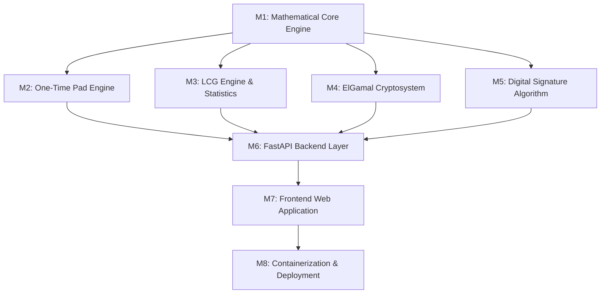

# Dependency Graph: Cryptography Pedagogy Platform

### Module Dependencies
1. **Math Engine** is foundational:
   - Used by LCG for Hull-Dobell ($\gcd$, prime factors).
   - Used by ElGamal for prime generation, primitive roots, modular inverse, and modular exponentiation.
   - Used by DSA for $(p, q, g)$ generation, modular inverse, and verification arithmetic.
2. **Engines (M2, M3, M4, M5)** are completely independent of each other and can be verified in isolation.
3. **Backend API (M6)** depends on all 4 engines.
4. **Frontend UI (M7)** depends on Backend API schemas.
5. **Deployment (M8)** bundles both Backend and Frontend.
