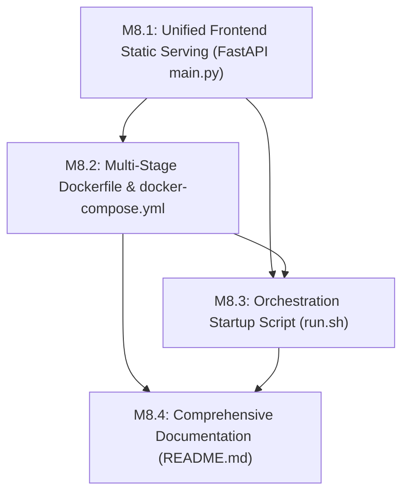

# Context Packet 8: Milestone 8 Packaging, Containerization, Production Serving & Deployment Guide

## 1. Milestone Goal
Deliver a production-ready, unified packaging and deployment architecture for the Cryptography Pedagogy Platform. Milestone 8 transitions the platform from separate backend and frontend development environments into a consolidated, single-container and single-script deployment experience. 

The milestone achieves:
1. **Unified Production Serving**: FastAPI mounts and serves the compiled React Single Page Application (`frontend/dist`) with content-negotiation HTML delivery and SPA routing fallback, while preserving full JSON API compatibility and passing all 282 backend tests.
2. **Multi-Stage Containerization**: A lightweight, multi-stage `Dockerfile` (Node 22 Alpine builder -> Python 3.12 slim runner) producing a single secure container exposing port 8000, complemented by `docker-compose.yml` and pinned dependencies.
3. **Universal Orchestration Script (`run.sh`)**: An executable shell orchestration script supporting `dev`, `prod`, `test`, and `docker` workflows with clean process lifecycle management.
4. **Comprehensive Documentation (`README.md`)**: In-depth, pedagogy-first documentation covering the mathematical foundations and vulnerabilities of all 4 pillars (OTP, LCG, ElGamal, DSA), system architecture diagrams, API reference, quickstart, and deployment guides.

---

## 2. Granular Sub-Milestone Decomposition

### M8.1: Unified Frontend Production Static File Serving via FastAPI
* **Responsibility**: Extend `backend/main.py` to optionally detect, mount, and serve `frontend/dist`.
* **Key Implementation Details**:
  - Check if `frontend/dist` directory exists on server startup.
  - Mount `/assets` to `frontend/dist/assets` via `starlette.staticfiles.StaticFiles`.
  - Update root route (`GET /`) to perform HTTP content negotiation:
    - If client requests `Accept: text/html` (web browser) and `frontend/dist/index.html` exists, serve `FileResponse("frontend/dist/index.html")`.
    - If client requests JSON or `Accept: application/json` (API clients / tests), return typed `RootResponse`.
  - Add catch-all SPA client-side fallback route for non-API GET requests (excluding `/api/*`, `/docs`, `/redoc`, `/openapi.json`) to return `frontend/dist/index.html`.
  - Ensure zero regressions: all 282 backend tests in `backend/tests/` must pass without modifications to test assertions.
* **Context**: [context-packet-8.1.md](file:///Users/charancherry/dev/ccWorkSpace/CNS/.claude/state/execution/context-packet-8.1.md)

### M8.2: Production Multi-stage Dockerfile and docker-compose.yml
* **Responsibility**: Containerize the unified application into an optimized, secure OCI container image.
* **Key Implementation Details**:
  - Stage 1 (`frontend-builder`): `node:22-alpine`, install dependencies, run `npm run build` to output `/app/frontend/dist`.
  - Stage 2 (`runner`): `python:3.12-slim`, install curl for healthcheck, install pinned dependencies from `backend/requirements.txt`, copy `backend/` and `/app/frontend/dist`.
  - Non-root user configuration (`appuser` with UID 10001) for container hardening.
  - Container health check monitoring `GET /api/v1/health`.
  - Single exposed port: `8000`.
  - `docker-compose.yml` for single-command `docker compose up --build`.
  - Clean `.dockerignore` ignoring node_modules, cache dirs, git, and local virtualenvs.
  - Pinned `backend/requirements.txt`.
* **Context**: [context-packet-8.2.md](file:///Users/charancherry/dev/ccWorkSpace/CNS/.claude/state/execution/context-packet-8.2.md)

### M8.3: Universal Orchestration Startup Script (`run.sh`)
* **Responsibility**: Provide a bulletproof executable shell entrypoint for developers, evaluators, and production runners.
* **Key Implementation Details**:
  - `./run.sh dev`: Starts FastAPI backend on port 8000 and Vite dev server on port 5173 with concurrent logging and clean SIGINT/SIGTERM trap cleanup.
  - `./run.sh prod`: Installs frontend dependencies, builds production bundle, and launches unified FastAPI server on port 8000.
  - `./run.sh test`: Executes full 282 backend pytest suite and runs frontend type-checking (`tsc --noEmit`) and build test.
  - `./run.sh docker`: Builds and starts Docker container via `docker compose up --build`.
  - Helpful colored CLI diagnostics and usage instructions.
* **Context**: [context-packet-8.3.md](file:///Users/charancherry/dev/ccWorkSpace/CNS/.claude/state/execution/context-packet-8.3.md)

### M8.4: Comprehensive Project Documentation & Hosting Guide (`README.md`)
* **Responsibility**: Authoritative, publication-grade documentation for academic evaluation and production hosting.
* **Key Implementation Details**:
  - Pedagogical depth: LaTeX/KaTeX mathematical formulations for all 4 pillars and proofs for key cancellation, Hull-Dobell, Marsaglia lattice hyperplanes, ElGamal homomorphic multiplication, and Sony PS3 DSA private key recovery.
  - Interactive Labs overview with screenshots/feature highlights.
  - System Architecture Mermaid diagrams and technology stack comparison.
  - Complete REST API specification reference table covering all 24+ endpoints.
  - Multi-environment quickstart guides (Local dev, Unified prod, Docker).
  - Cloud deployment guidelines (AWS, GCP, DigitalOcean, Render).
* **Context**: [context-packet-8.4.md](file:///Users/charancherry/dev/ccWorkSpace/CNS/.claude/state/execution/context-packet-8.4.md)

---

## 3. Dependency Graph & Execution Order

* **Rationale**:
  1. M8.1 must be completed first so that FastAPI knows how to serve `frontend/dist` when packaged.
  2. M8.2 builds on M8.1 by copying `frontend/dist` into the container image and running the unified server.
  3. M8.3 requires both local commands (dev/prod/test) and Docker commands (`docker compose`).
  4. M8.4 documents the entire completed project, linking all scripts, endpoints, Docker commands, and mathematical formulations.

---

## 4. Verification and Acceptance Criteria
1. **FastAPI Static Serving**:
   - Accessing `http://localhost:8000/` in browser loads React SPA.
   - Accessing `curl -H "Accept: application/json" http://localhost:8000/` returns JSON `RootResponse`.
   - All 282 backend tests pass: `pytest backend/tests` returns 282 passed.
2. **Docker Packaging**:
   - `docker compose build` succeeds with zero errors.
   - Container starts, health check passes (`/api/v1/health` status 200), and frontend is served on port 8000.
3. **Orchestration Script**:
   - `./run.sh dev`, `./run.sh prod`, `./run.sh test`, `./run.sh docker` all function deterministically.
   - Ctrl+C terminates child processes without orphan processes left listening on ports 8000 or 5173.
4. **Documentation**:
   - `README.md` is complete, comprehensive, and accurately details all mathematics, vulnerabilities, APIs, and deployment steps.
