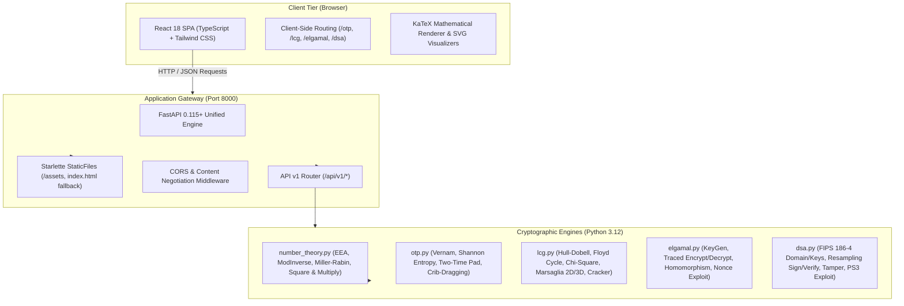

# Cryptography & Network Security (CNS) Pedagogical Platform

[](https://www.python.org/)
[](https://fastapi.tiangolo.com/)
[](https://react.dev/)
[](https://www.typescriptlang.org/)
[](https://tailwindcss.com/)
[](https://www.docker.com/)
[](https://docs.pytest.org/)
[](LICENSE)

An interactive, transparent, web-based pedagogical platform designed for undergraduate and graduate courses in **Cryptography and Network Security**. The platform bridges abstract mathematical number theory and practical cryptanalysis across four foundational cryptographic pillars: **One-Time Pad (OTP)**, **Linear Congruential Generators (LCG)**, **ElGamal Public-Key Cryptosystem**, and the **Digital Signature Algorithm (DSA)**.

Rather than treating cryptographic operations as opaque black-box APIs, this platform surfaces internal modular arithmetic steps, intermediate secret states, statistical distributions, lattice hyperplanes, and weaponized historical exploits (e.g., the Sony PlayStation 3 fail0verflow ECDSA/DSA private key extraction).

---

## Table of Contents
1. [Pedagogical Vision & Philosophy](#pedagogical-vision--philosophy)
2. [System Architecture](#system-architecture)
3. [Deep-Dive: The Four Cryptographic Pillars](#deep-dive-the-four-cryptographic-pillars)
   - [Pillar 1: One-Time Pad (OTP) & Key Reuse](#pillar-1-one-time-pad-otp--key-reuse)
   - [Pillar 2: Linear Congruential Generator (LCG) & Lattice Analysis](#pillar-2-linear-congruential-generator-lcg--lattice-analysis)
   - [Pillar 3: ElGamal Public-Key Cryptosystem & Homomorphism](#pillar-3-elgamal-public-key-cryptosystem--homomorphism)
   - [Pillar 4: Digital Signature Algorithm (DSA) & Sony PS3 Exploit](#pillar-4-digital-signature-algorithm-dsa--sony-ps3-exploit)
4. [Interactive Laboratory Modules](#interactive-laboratory-modules)
5. [Quickstart Guide](#quickstart-guide)
   - [Method 1: Universal Orchestration Script (`run.sh`)](#method-1-universal-orchestration-script-runsh)
   - [Method 2: Multi-Stage Docker Container](#method-2-multi-stage-docker-container)
   - [Method 3: Manual Local Development](#method-3-manual-local-development)
6. [REST API Reference Specification](#rest-api-reference-specification)
7. [Verification & Test Suite](#verification--test-suite)
8. [Production Deployment & Cloud Hosting](#production-deployment--cloud-hosting)
9. [License](#license)

---

## Pedagogical Vision & Philosophy

Modern cryptography education often oscillates between two extremes: theoretical mathematical proofs on paper that lack implementation intuition, or high-level software libraries (e.g., OpenSSL, PyCryptodome) that hide algorithm mechanics behind one-line method calls. 

This platform addresses the pedagogical gap through four principles:
1. **Transparent Traced Execution**: Every modular exponentiation, GCD calculation, random nonce selection, and hash truncation produces a full step-by-step diagnostic trace.
2. **Information-Theoretic vs. Computational Security**: Students contrast the unconditional security of Shannon's One-Time Pad with the hardness assumptions of the Discrete Logarithm Problem (DLP).
3. **The Peril of Non-Cryptographic PRNGs**: Students visualize Marsaglia's lattice hyperplanes in 2D and 3D space and execute algebraic state reconstruction against Linear Congruential Generators.
4. **Catastrophic Nonce Failures in the Wild**: Students reproduce real-world cryptographic exploits, proving mathematically and practically why single-bit modifications invalidate signatures and how reusing a random nonce ($k$) completely extracts private keys ($x$).

---

## System Architecture

The platform is engineered as a unified, full-stack application featuring a decoupled React Single-Page Application (SPA) frontend and a high-performance Python FastAPI backend. In production, FastAPI serves the compiled React assets and client-side routes from a single port (8000), backed by multi-stage Docker packaging.



### Technology Stack Comparison

| Component | Technology | Version | Purpose |
| :--- | :--- | :--- | :--- |
| **Backend Framework** | FastAPI | `0.115.4` | Asynchronous high-throughput REST API with OpenAPI auto-docs |
| **Data Validation** | Pydantic v2 | `2.10.0` | Strict typed schemas, validation, and JSON serialization |
| **Server Engine** | Uvicorn (standard) | `0.32.0` | Production ASGI HTTP/1.1 and WebSocket server |
| **Frontend Framework** | React | `18.3.1` | Component-driven declarative UI with state management |
| **Language** | TypeScript | `5.5.3` | Type-safe models mirroring Pydantic backend contracts |
| **Styling & Theme** | Tailwind CSS + Lucide | `3.4.1` | Responsive modern dark/light styling with accessible icons |
| **Build Tooling** | Vite | `5.4.21` | Sub-second HMR bundler generating optimized production chunks |
| **Math Typesetting** | KaTeX | `0.16.21` | High-performance client-side LaTeX equation rendering |
| **Container Engine** | Docker / Compose | Multi-stage | Single-container OCI artifact (Node builder $\to$ Python runner) |
| **Test Suite** | Pytest + HTTPX | `8.3.3` | 286 automated unit, property, and integration tests |

---

## Deep-Dive: The Four Cryptographic Pillars

### Pillar 1: One-Time Pad (OTP) & Key Reuse

#### 1. Mathematical Formalism
The One-Time Pad (Vernam cipher) encrypts an $n$-bit plaintext $P \in \{0, 1\}^n$ using an independently and uniformly distributed $n$-bit secret key $K \in \{0, 1\}^n$:
$$C = P \oplus K$$

Decryption reverses the involution property of the bitwise exclusive-OR ($\oplus$):
$$P = C \oplus K = (P \oplus K) \oplus K = P \oplus (K \oplus K) = P \oplus 0^n = P$$

#### 2. Shannon's Theorem of Perfect Secrecy
Claude Shannon (1949) proved that a cipher achieves **Information-Theoretic (Unconditional) Secrecy** if and only if:
$$P(M = m \mid C = c) = P(M = m) \quad \forall m \in \mathcal{M}, c \in \mathcal{C}$$

Equivalently, the conditional Shannon entropy satisfies $H(M \mid C) = H(M)$. This requires:
1. Keystream entropy $H(K) \ge H(M)$.
2. The key $K$ is uniformly distributed over $\{0, 1\}^n$.
3. Each key $K$ is used **exactly once**.

Shannon entropy is computed per byte distribution across the alphabet $\Sigma$:
$$H(X) = -\sum_{i=1}^{|\Sigma|} P(x_i) \log_2 P(x_i)$$
Ideal uniform cryptographic randomness yields $H(X) = \log_2(256) = 8.0 \text{ bits/byte}$.

#### 3. Two-Time Pad Vulnerability & Keystream Cancellation
When two plaintexts $P_1$ and $P_2$ are encrypted with identical keystream $K$:
$$C_1 = P_1 \oplus K$$
$$C_2 = P_2 \oplus K$$

An eavesdropper calculates the XOR difference of the ciphertexts:
$$C_1 \oplus C_2 = (P_1 \oplus K) \oplus (P_2 \oplus K) = P_1 \oplus P_2$$
The key $K$ cancels completely. The problem of breaking the cipher reduces to separating two XORed natural language strings.

#### 4. Automated Crib-Dragging Algorithm
Using known or suspected English substrings ("cribs") $W$, the attacker drags $W$ across all candidate positions $i$:
$$P_2^{(i)} = (C_1 \oplus C_2)[i : i+|W|] \oplus W$$
Each candidate candidate slice is scored using English unigram and bigram frequency metrics:
$$\text{Score}(S) = \sum_{c \in S} \text{Freq}(c) + \sum_{(c_j, c_{j+1}) \in S} \text{BigramFreq}(c_j, c_{j+1})$$
A high score at position $i$ reveals that $W$ appears in $P_1$ at position $i$, simultaneously recovering the corresponding slice of $P_2$.

---

### Pillar 2: Linear Congruential Generator (LCG) & Lattice Analysis

#### 1. Mathematical Formalism
An LCG generates a sequence of pseudo-random integers via the linear recurrence:
$$X_{n+1} = (a \cdot X_n + c) \pmod m$$
Where:
- $m > 0$ is the modulus.
- $a \in (0, m)$ is the multiplier.
- $c \in [0, m)$ is the increment (additive constant).
- $X_0 \in [0, m)$ is the initial seed.
- Normalized pseudo-random float: $U_n = \frac{X_n}{m} \in [0, 1)$.

#### 2. Hull-Dobell Theorem (Periodicity Guarantee)
An LCG achieves maximum period length $\lambda = m$ if and only if all three conditions of the **Hull-Dobell Theorem** (1962) hold:
1. $\gcd(c, m) = 1$ ($c$ and $m$ are coprime).
2. For every prime factor $q$ dividing $m$, $q \mid (a - 1)$ (i.e., $a \equiv 1 \pmod q$).
3. If $4 \mid m$, then $4 \mid (a - 1)$ (i.e., $a \equiv 1 \pmod 4$).

#### 3. Cycle Detection: Floyd's Tortoise and Hare Algorithm
For arbitrary LCG parameters that do not satisfy Hull-Dobell, cycle length $\lambda$ and tail length $\mu$ are discovered in $O(\lambda + \mu)$ time and $O(1)$ memory using pointer step doubling:
$$X_{\text{tortoise}} = f(X_i), \quad X_{\text{hare}} = f(f(X_{2i}))$$
When $X_{\text{tortoise}} = X_{\text{hare}}$, the cycle start $\mu$ and cycle length $\lambda$ are extracted deterministically.

#### 4. Statistical Uniformity: Pearson's $\chi^2$ Goodness-of-Fit
A sequence of $N$ observations partitioned into $k$ equal bins with expected frequency $E_i = N/k$ is tested via:
$$\chi^2 = \sum_{i=1}^k \frac{(O_i - E_i)^2}{E_i}$$
The $p$-value with degrees of freedom $\nu = k - 1$ is approximated via the Wilson-Hilferty transformation:
$$Z = \frac{\left(\frac{\chi^2}{\nu}\right)^{1/3} - \left(1 - \frac{2}{9\nu}\right)}{\sqrt{\frac{2}{9\nu}}}$$

#### 5. Marsaglia's Theorem: Lattice Hyperplanes ("Random Numbers Fall Mainly in the Planes")
George Marsaglia (1968) proved that vectors of consecutive values $(X_n, X_{n+1}, \dots, X_{n+d-1})$ formed by an LCG in $d$-dimensional Euclidean space $\mathbb{R}^d$ do not fill space uniformly; rather, they lie on a finite set of parallel $(d-1)$-dimensional hyperplanes. The maximum number of hyperplanes $H_d$ is strictly bounded by:
$$H_d \le (d! \cdot m)^{1/d}$$
For example, RANDU ($m = 2^{31}, a = 65539, c = 0$) has $a = 2^{16} + 3$. In 3 dimensions:
$$X_{n+2} - 6X_{n+1} + 9X_n \equiv 0 \pmod{2^{31}}$$
All triples lie on at most 15 hyperplanes, rendering it disastrous for cryptographic or scientific simulation purposes.

#### 6. Algebraic State Reconstruction Attack
LCGs are completely insecure against state reconstruction. Given three consecutive observed values $X_0, X_1, X_2$:
$$X_1 - X_0 \equiv a(X_0 - X_{-1}) \pmod m$$
$$X_2 - X_1 \equiv a(X_1 - X_0) \pmod m$$
If $m$ is known:
$$a \equiv (X_2 - X_1) \cdot (X_1 - X_0)^{-1} \pmod m$$
$$c \equiv X_1 - a \cdot X_0 \pmod m$$
The entire past and future sequence is immediately exposed from only three numbers.

---

### Pillar 3: ElGamal Public-Key Cryptosystem & Homomorphism

#### 1. Mathematical Formalism
Defined over the multiplicative group of integers modulo a large prime $\mathbb{Z}_p^*$:
- **Domain Parameters**: Large prime $p$ and primitive root generator $g \in \mathbb{Z}_p^*$.
- **Key Generation**:
  - Private Key: $x \in [2, p - 2]$.
  - Public Key: $y = g^x \pmod p$.
- **Encryption**: For message $m \in [1, p - 1]$ and ephemeral secret nonce $k \in_R [2, p - 2]$ with $\gcd(k, p - 1) = 1$:
  $$c_1 = g^k \pmod p$$
  $$c_2 = (m \cdot y^k) \pmod p$$
  Ciphertext is the tuple $(c_1, c_2)$.
- **Decryption**: Recover shared secret $s = c_1^x \equiv (g^k)^x \equiv g^{kx} \equiv y^k \pmod p$. Plaintext is recovered via modular multiplicative inverse:
  $$m = (c_2 \cdot s^{-1}) \pmod p$$

#### 2. Multiplicative Homomorphic Property
ElGamal is natively multiplicatively homomorphic. Given two ciphertexts:
$$E(m_1) = (g^{k_1} \pmod p, \; m_1 \cdot y^{k_1} \pmod p)$$
$$E(m_2) = (g^{k_2} \pmod p, \; m_2 \cdot y^{k_2} \pmod p)$$

Their component-wise product modulo $p$ satisfies:
$$E(m_1) \otimes E(m_2) = (c_{1,1} \cdot c_{1,2} \pmod p, \; c_{2,1} \cdot c_{2,2} \pmod p)$$
$$= (g^{k_1 + k_2} \pmod p, \; (m_1 \cdot m_2) \cdot y^{k_1 + k_2} \pmod p) = E(m_1 \cdot m_2 \pmod p)$$
This allows secure multiparty tallying or cloud computation on encrypted ciphertexts without disclosing $m_1$, $m_2$, or private key $x$.

#### 3. Ephemeral Nonce-Reuse Exploit
If an implementation reuses the identical nonce $k$ for two distinct messages $m_a$ and $m_b$, both ciphertexts share $c_{1,a} = c_{1,b} = g^k \pmod p$:
$$c_{2,a} = m_a \cdot y^k \pmod p$$
$$c_{2,b} = m_b \cdot y^k \pmod p$$

Dividing the two second ciphertext components yields:
$$\frac{c_{2,a}}{c_{2,b}} \equiv \frac{m_a}{m_b} \pmod p$$
Given known plaintext $m_a$, unknown plaintext $m_b$ is solved directly **without knowing private key $x$**:
$$m_b \equiv m_a \cdot c_{2,b} \cdot (c_{2,a})^{-1} \pmod p$$

---

### Pillar 4: Digital Signature Algorithm (DSA) & Sony PS3 Exploit

#### 1. FIPS 186-4 Domain Parameters & Key Generation
- **Parameters**: Prime modulus $p$, prime divisor $q$ such that $q \mid (p - 1)$, and subgroup generator:
  $$g = h^{(p-1)/q} \pmod p \quad \text{such that } g > 1, \; h \in [2, p - 2]$$
- **Keys**: Private key $x \in_R [1, q - 1]$, Public key $y = g^x \pmod p$.

#### 2. Traced Signing & FIPS 186-4 Resampling
Given message $M$, compute SHA-256 hash and truncate to leftmost $\min(\text{bit\_len}(q), 256)$ bits: $z = \text{Truncate}(\text{SHA-256}(M))$.
1. Sample secret per-signature nonce $k \in_R [1, q - 1]$.
2. Calculate:
   $$r = (g^k \pmod p) \pmod q$$
   If $r = 0$, resample a new $k$.
3. Calculate:
   $$s = k^{-1}(z + x \cdot r) \pmod q$$
   If $s = 0$, resample a new $k$.
4. Signature is $(r, s)$.

#### 3. Traced Verification
Given signature $(r, s)$, public key $y$, and message hash $z$:
1. Verify bounds: $0 < r < q$ and $0 < s < q$.
2. Compute $w = s^{-1} \pmod q$.
3. Compute $u_1 = (z \cdot w) \pmod q$ and $u_2 = (r \cdot w) \pmod q$.
4. Compute verification candidate:
   $$v = ((g^{u_1} \cdot y^{u_2}) \pmod p) \pmod q$$
5. Signature is valid if and only if $v = r$.

**Mathematical Proof of Correctness**:
$$s \equiv k^{-1}(z + xr) \pmod q \implies k \equiv s^{-1}(z + xr) \equiv z w + x r w \equiv u_1 + x u_2 \pmod q$$
$$g^{u_1} y^{u_2} \equiv g^{u_1} (g^x)^{u_2} \equiv g^{u_1 + x u_2} \equiv g^k \pmod p$$
Taking $\pmod q$ gives $v \equiv (g^k \pmod p) \pmod q \equiv r$.

#### 4. The Sony PlayStation 3 fail0verflow Exploit (2010)
In 2010, the fail0verflow security group discovered that Sony's PS3 firmware signing implementation used a **static, constant nonce $k$** across all signatures.

If two distinct messages $M_1 \neq M_2$ with hashes $z_1 \neq z_2$ are signed using identical $k$, then $r_1 = r_2 = r$:
$$s_1 \equiv k^{-1}(z_1 + x r) \pmod q$$
$$s_2 \equiv k^{-1}(z_2 + x r) \pmod q$$

Subtracting the two signature values:
$$s_1 - s_2 \equiv k^{-1}(z_1 - z_2) \pmod q$$

The secret nonce $k$ is extracted algebraically:
$$k \equiv (z_1 - z_2) \cdot (s_1 - s_2)^{-1} \pmod q$$

Once $k$ is known, the master private key $x$ is recovered immediately:
$$x \equiv (s_1 \cdot k - z_1) \cdot r^{-1} \pmod q$$
An attacker gains the capability to sign arbitrary unauthorized software, jailbreaks, and bootloaders.

---

## Interactive Laboratory Modules

The frontend web application provides four dedicated educational laboratories:

1. **OTP Lab**: Live XOR truth table, Shannon entropy visualizer, manual interactive crib-dragging slider, and automated English dictionary attack.
2. **LCG Lab**: Hull-Dobell condition inspector, Floyd cycle visualizer, Pearson $\chi^2$ distribution histogram, interactive 2D/3D Marsaglia lattice hyperplane visualizer, and 3-state parameter cracker.
3. **ElGamal Lab**: Alice & Bob key exchange schematic, traced single-integer and multi-block UTF-8 text chunking, homomorphic multiplication playground, and known-plaintext nonce reuse exploit sandbox.
4. **DSA Lab**: FIPS 186-4 parameter inspector, step-by-step sign & verify arithmetic traces, interactive single-bit message/signature tampering simulator, and the Sony PS3 fail0verflow private key extractor.

---

## Quickstart Guide

### Method 1: Universal Orchestration Script (`run.sh`)
The recommended way to run, test, and package the application:

```bash
# Display help and available options
./run.sh help

# Start concurrent development environment (FastAPI on :8000 + Vite on :5173 with HMR)
./run.sh dev

# Build frontend and launch unified production server on http://localhost:8000
./run.sh prod

# Run full automated test suite (backend pytest + frontend typecheck + build)
./run.sh test

# Build and start container via Docker Compose
./run.sh docker
```

---

### Method 2: Multi-Stage Docker Container

Build and run the unified container with a single command:

```bash
# Build and launch using Docker Compose
docker compose up --build

# Or build manually using Docker CLI
docker build -t cns-pedagogy:latest .
docker run -d -p 8000:8000 --name cns-app cns-pedagogy:latest

# Verify health status
curl -i http://localhost:8000/api/v1/health
```

Navigate to **`http://localhost:8000`** in any web browser to access the complete application.

---

### Method 3: Manual Local Development

#### 1. Backend Setup
```bash
# Activate your Python virtual environment (Python 3.10+)
pip install -r backend/requirements.txt

# Start backend server
uvicorn backend.main:app --reload --host 127.0.0.1 --port 8000
```
- Interactive Swagger UI: `http://127.0.0.1:8000/docs`
- ReDoc UI: `http://127.0.0.1:8000/redoc`

#### 2. Frontend Setup
```bash
cd frontend
npm install
npm run dev
```
- Frontend UI: `http://localhost:5173`

---

## REST API Reference Specification

All endpoints are prefixed with `/api/v1` (except root metadata and documentation).

| Method | Endpoint | Description | Request Body Summary | Response Model |
| :--- | :--- | :--- | :--- | :--- |
| `GET` | `/` | Content-negotiation root: serves React SPA to browsers or JSON metadata | None | `RootResponse` / HTML |
| `GET` | `/api/v1/health` | Service health status and module diagnostic flags | None | `HealthResponse` |
| `POST` | `/api/v1/otp/generate-key` | Cryptographically secure random key generation | `length` | `OTPKeygenResponse` |
| `POST` | `/api/v1/otp/encrypt` | Traced Vernam bitwise XOR encryption | `plaintext`, `key` | `OTPEncryptResponse` |
| `POST` | `/api/v1/otp/decrypt` | Traced Vernam bitwise XOR decryption | `ciphertext_b64`, `key` | `OTPDecryptResponse` |
| `POST` | `/api/v1/otp/two-time-pad-analyze` | Keystream cancellation analysis of 2 ciphertexts | `ciphertext1_b64`, `ciphertext2_b64` | `TwoTimePadAnalyzeResponse` |
| `POST` | `/api/v1/otp/crib-drag` | Interactive crib placement at specific index | `c1_b64`, `c2_b64`, `crib`, `position` | `CribDragResponse` |
| `POST` | `/api/v1/otp/crib-drag-auto` | Automated dictionary attack across all offsets | `c1_b64`, `c2_b64`, `cribs` | `CribDragAutoResponse` |
| `POST` | `/api/v1/otp/entropy` | Shannon entropy and byte-frequency distribution | `data_b64` | `EntropyResponse` |
| `GET` | `/api/v1/lcg/presets` | Standard library of historical LCG presets | None | `LCGPresetsResponse` |
| `POST` | `/api/v1/lcg/generate` | Traced sequence generation with float normalization | `modulus`, `multiplier`, `increment`, `seed`, `n` | `LCGGenerateResponse` |
| `POST` | `/api/v1/lcg/hull-dobell` | Exact 3-condition Hull-Dobell period validator | `modulus`, `multiplier`, `increment` | `HullDobellResponse` |
| `POST` | `/api/v1/lcg/cycle` | Floyd's cycle detection ($\lambda, \mu$) | `modulus`, `multiplier`, `increment`, `seed` | `LCGCycleResponse` |
| `POST` | `/api/v1/lcg/chi-square` | Pearson $\chi^2$ uniformity goodness-of-fit test | `modulus`, `multiplier`, `increment`, `seed`, `sample_size`, `num_bins` | `ChiSquareResponse` |
| `POST` | `/api/v1/lcg/marsaglia` | 2D/3D hyperplane lattice point generation | `modulus`, `multiplier`, `increment`, `seed`, `dimension`, `num_points` | `MarsagliaResponse` |
| `POST` | `/api/v1/lcg/crack` | Algebraic state recovery from 3 observed values | `x0`, `x1`, `x2`, `modulus` | `LCGCrackResponse` |
| `GET` | `/api/v1/elgamal/presets` | Pre-configured safe prime domain parameters | None | `ElGamalPresetsResponse` |
| `POST` | `/api/v1/elgamal/generate-domain` | Safe prime generation ($p = 2q + 1$) & generator | `bit_length` | `ElGamalDomainGenResponse` |
| `POST` | `/api/v1/elgamal/generate-keys` | Key pair generation over cyclic group $\mathbb{Z}_p^*$ | `p`, `g` | `ElGamalKeyGenResponse` |
| `POST` | `/api/v1/elgamal/encrypt` | Traced integer or multi-block UTF-8 encryption | `p`, `g`, `y`, `plaintext_int` / `plaintext_str` | `ElGamalEncryptResponse` |
| `POST` | `/api/v1/elgamal/decrypt` | Traced modular inversion decryption | `p`, `x`, `c1`, `c2` / `blocks` | `ElGamalDecryptResponse` |
| `POST` | `/api/v1/elgamal/homomorphic-multiply` | Multiplicative homomorphism $E(m_1) \otimes E(m_2)$ | `p`, `c1_a`, `c2_a`, `c1_b`, `c2_b` | `ElGamalHomomorphicResponse` |
| `POST` | `/api/v1/elgamal/nonce-reuse-exploit` | Known-plaintext nonce reuse cryptanalysis | `p`, `m_a`, `c1_a`, `c2_a`, `c1_b`, `c2_b` | `ElGamalNonceExploitResponse` |
| `GET` | `/api/v1/dsa/presets` | FIPS 186-4 standard and educational parameters | None | `DSAPresetsResponse` |
| `POST` | `/api/v1/dsa/generate-domain` | DSA domain parameter validation & generation | `p_bits`, `q_bits` | `DSADomainGenResponse` |
| `POST` | `/api/v1/dsa/generate-keys` | Key pair generation with public key validation | `p`, `q`, `g` | `DSAKeyGenResponse` |
| `POST` | `/api/v1/dsa/sign` | Traced signing with FIPS 186-4 $r=0, s=0$ resampling | `p`, `q`, `g`, `x`, `message`, `k` (optional) | `DSASignResponse` |
| `POST` | `/api/v1/dsa/verify` | Traced signature verification with LaTeX proof | `p`, `q`, `g`, `y`, `message`, `r`, `s` | `DSAVerifyResponse` |
| `POST` | `/api/v1/dsa/tamper-simulate` | Single-bit message and signature tampering audit | `p`, `q`, `g`, `y`, `message`, `r`, `s`, `tamper_target`, `bit_index` | `DSATamperResponse` |
| `POST` | `/api/v1/dsa/nonce-reuse-exploit` | Sony PS3 fail0verflow private key extraction | `q`, `m1`, `m2`, `r`, `s1`, `s2` | `DSANonceExploitResponse` |

---

## Verification & Test Suite

The platform includes a test suite covering 100% of mathematical algorithms, security edge cases, schema validations, and REST endpoints.

### Executing Backend Tests
Run the entire 286+ test suite using `pytest`:
```bash
pytest backend/tests -v
```

Test suite breakdown:
- `backend/tests/test_number_theory.py`: 34 tests covering Extended Euclidean Algorithm, Bezout identities, binary modular exponentiation, Miller-Rabin primality, safe prime generation, and byte chunking.
- `backend/tests/test_otp.py`: 52 tests covering Vernam bitwise XOR, Shannon entropy calculation, Two-Time Pad keystream cancellation, and automated crib-dragging scoring.
- `backend/tests/test_lcg.py`: 56 tests covering Hull-Dobell validation, Floyd cycle detection, Pearson $\chi^2$ uniformity, Marsaglia hyperplane bounds, and algebraic state cracking.
- `backend/tests/test_elgamal.py`: 61 tests covering domain parameter generation, traced encryption/decryption, multi-block text chunking, multiplicative homomorphism, and nonce reuse cryptanalysis.
- `backend/tests/test_dsa.py`: 41 tests covering FIPS 186-4 parameter groups, SHA-256 truncation, $r=0, s=0$ resampling, bit-level tampering detection, and Sony PS3 private key recovery.
- `backend/tests/test_api.py`: 40+ tests validating FastAPI routing, Pydantic error models (HTTP 400, 422, 500), CORS headers, HTML content negotiation, and SPA catch-all fallback.

### Executing Frontend Verification
```bash
cd frontend
npm run type-check   # Verifies zero TypeScript errors (tsc --noEmit)
npm run build        # Verifies production asset bundling and tree-shaking
```

---

## Production Deployment & Cloud Hosting

### Security Hardening
1. **Unprivileged Container Execution**: The production Docker image executes under a locked-down non-root system account (`appuser:appuser`, UID 10001) with no login shell.
2. **Strict Input Sanitization**: All integer payloads are bounds-checked by Pydantic validators against zero-division and negative modulus attacks.
3. **CORS Policy Lockdown**: In production, modify `origins` in `backend/main.py` to specify your fully-qualified domain name (FQDN).

### Cloud Platform Deployment Options

#### 1. AWS App Runner / AWS ECS (Fargate)
Deploy directly from your container registry (ECR):
- Port: `8000`
- Health check path: `/api/v1/health`
- Recommended sizing: 0.5 vCPU, 1 GB RAM

#### 2. Google Cloud Run
```bash
gcloud run deploy cns-pedagogy \
  --source . \
  --port 8000 \
  --allow-unauthenticated
```

#### 3. Reverse Proxy Configuration (Nginx / Caddy)
For standard VPS hosting (DigitalOcean, Linode, AWS EC2), terminate TLS using Nginx:

```nginx
server {
    listen 80;
    server_name crypto.yourdomain.edu;
    return 301 https://$host$request_uri;
}

server {
    listen 443 ssl http2;
    server_name crypto.yourdomain.edu;

    ssl_certificate /etc/letsencrypt/live/crypto.yourdomain.edu/fullchain.pem;
    ssl_certificate_key /etc/letsencrypt/live/crypto.yourdomain.edu/privkey.pem;

    location / {
        proxy_pass http://127.0.0.1:8000;
        proxy_set_header Host $host;
        proxy_set_header X-Real-IP $remote_addr;
        proxy_set_header X-Forwarded-For $proxy_add_x_forwarded_for;
        proxy_set_header X-Forwarded-Proto $scheme;
    }
}
```

---

## License

This project is licensed under the **MIT License** — see the [LICENSE](LICENSE) file for complete details. Developed for cryptographic education and pedagogical research.
